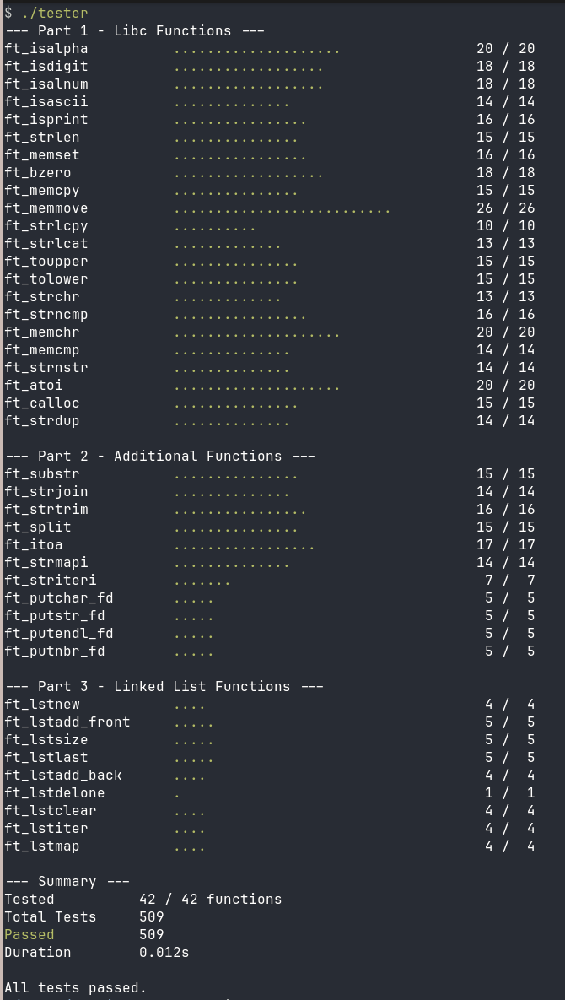

# 42 Libft Tester

[Watch 42 Libft Tester Showcase Video on Youtube](https://www.youtube.com/watch?v=tkeJa7gTiRA) (1.1.0)

A fast, cross-platform unit tester for the 42 school `libft` project. Executes over 500 tests in under 0.02 seconds.<br>
Currently up-to-date with Libft subject version 19.3<br>

# Quick Start
You need a Linux or macOS machine with `gcc` or `clang`, and your compiled `libft.a` library.
1. Clone this tester next to your libft repository:
```bash
git clone https://github.com/ylam21/42_Libft_Tester.git
cd 42_Libft_Tester
```
2. Build and run the tester against your archive:
```bash
./build.sh ../libft/libft.a
./tester
 ```
*(Run `./tester help` for advanced command-line arguments).*

# Table of Contents
1. [What this tester DOES check](#what-this-tester-does-check)
2. [What this tester does NOT check](#what-this-tester-does-not-check)
3. [Setting up automated tests in your Libft Makefile](#setting-up-automated-tests-in-your-libft-makefile)
4. [Libft Subject Version Compatibility](#libft-subject-version-compatibility)
5. [Acknowledgments](#acknowledgments)



# What this tester DOES check
*   Checks correct outputs for all Libft functions.<br>
*   Checks memory leaks (using linker-level wrapping on Linux and flat namespace overrides on macOS).<br>
*   Checks segmentation faults, timeouts, bus errors, double frees using process isolation.<br>
*   Provides detailed hex and string memory dumps in failed_reports.txt for any failed tests.<br>

# What this tester does NOT check
*   Does NOT check if your libft project was written in accordance with the 42 Norm.<br>
*   Does NOT check your libft project's Makefile and its rules, flags, relinking, etc.<br>
*   Does NOT check if you declared any global variables in your project.<br>
*   Does NOT check if you used any unallowed functions in your project. <br>
*   Does NOT check for any README requirements.<br>

# Setting up automated tests in your Libft Makefile
Automate your testing by adding these rules directly to your `libft` Makefile:
```make
#  Path to the cloned tester
TESTER_DIR := ../42_Libft_Tester
TESTER_ARS := --set-timeout-ms 50

test: $(NAME)
	$(TESTER_DIR)/build.sh ./$(NAME)
	$(TESTER_DIR)/tester $(TESTER_ARGS)
	
# Add the tester binary to your existing fclean
fclean: clean
	$(RM) $(NAME) tester
	
.PHONY: all clean fclean re test
```
Now, just type `make test` inside your libft folder.

# Libft Subject Version Compatibility
If a newer subject version is released and the tester falls behind, please create an issue so it can be updated. Thank you.

## Acknowledgments
The base and OS layers of this project are derived from [RADDebugger](https://github.com/EpicGamesExt/raddebugger) by Epic Games. I would like to thank the RAD team for sharing their high-quality code, which significantly improved the robustness and portability of this tester.
